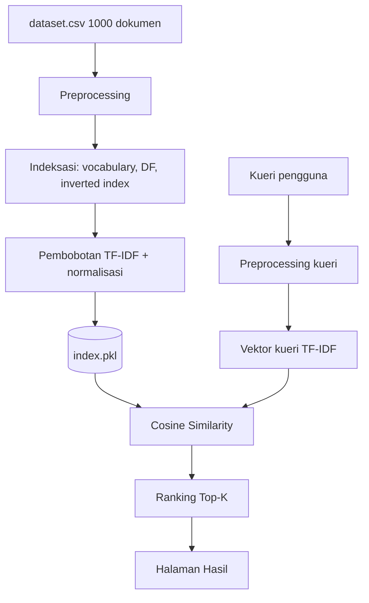

# Aplikasi Web Mesin Pencari Sederhana (VSM + TF-IDF)

## 1. Tujuan
Membangun aplikasi web search engine mandiri yang melakukan **indeksasi, pembobotan kata (TF-IDF), dan perangkingan dokumen** berdasarkan kueri pengguna dengan **Vector Space Model (VSM)** pada **1.000 dokumen** dari file CSV yang disediakan asisten praktikum.

## 2. Ruang Lingkup Fitur
| No | Fitur | File Dokumen |
|----|-------|--------------|
| 1 | Halaman Utama (Dashboard Pencarian) | `01-dashboard-pencarian.md` |
| 2 | Pra-proses Teks (Preprocessing Pipeline) | `02-preprocessing-pipeline.md` |
| 3 | Mesin Hitung VSM & Perangkingan | `03-vsm-engine.md` |
| 4 | Halaman Hasil Pencarian | `04-halaman-hasil.md` |

## 3. Teknologi yang Disarankan
| Komponen | Pilihan | Alasan |
|----------|---------|--------|
| Bahasa | Python 3.10+ | Ekosistem NLP kuat |
| Web framework | Flask | Ringan, mudah dipahami |
| Preprocessing | Sastrawi (stemmer & stopword Bahasa Indonesia) | Khusus Bahasa Indonesia |
| Data | pandas | Membaca CSV |
| Komputasi | Python murni / numpy | Implementasi VSM manual agar rumusnya terlihat jelas |
| Frontend | HTML + Jinja2 + CSS (opsional Bootstrap) | Sederhana |

> **Catatan:** Untuk tugas ini, hitung TF-IDF **secara manual** (jangan langsung memakai `TfidfVectorizer`), karena yang dinilai biasanya pemahaman prosesnya. `scikit-learn` boleh dipakai sebagai pembanding validasi.

## 4. Asumsi Dataset
File `dataset.csv` berisi 1.000 baris dengan kolom (sesuaikan dengan file asli dari asisten):

| Kolom | Keterangan |
|-------|-----------|
| `id` | Pengenal dokumen |
| `judul` | Judul dokumen |
| `isi` | Isi teks dokumen |

## 5. Struktur Proyek
```
search-engine/
├── app.py                  # Entry point Flask (routing)
├── requirements.txt
├── data/
│   ├── dataset.csv         # 1000 dokumen
│   └── index.pkl           # Cache hasil indeksasi (dibuat otomatis)
├── engine/
│   ├── __init__.py
│   ├── preprocess.py       # Fitur 2
│   └── vsm.py              # Fitur 3
├── templates/
│   ├── base.html
│   ├── index.html          # Fitur 1
│   └── results.html        # Fitur 4
└── static/
    └── style.css
```

## 6. Alur Sistem


## 7. Tahapan Pengerjaan (Roadmap)
1. Setup proyek & instalasi library
2. Load dan eksplorasi dataset
3. Implementasi preprocessing (Fitur 2)
4. Implementasi indeksasi & TF-IDF (Fitur 3)
5. Implementasi cosine similarity & ranking (Fitur 3)
6. Bangun UI dashboard (Fitur 1) dan halaman hasil (Fitur 4)
7. Pengujian dengan beberapa kueri
8. Penulisan laporan & demo

## 8. `requirements.txt`
```
Flask>=3.0
pandas>=2.0
numpy>=1.24
PySastrawi>=1.2.0
```

## 9. Rencana Pengujian Keseluruhan
| ID | Skenario | Hasil Diharapkan |
|----|----------|------------------|
| T1 | Kueri satu kata yang ada di dokumen | Dokumen relevan muncul, skor > 0 |
| T2 | Kueri beberapa kata | Dokumen dengan lebih banyak kata cocok berada di atas |
| T3 | Kueri berisi kata tak dikenal | Pesan "tidak ditemukan" |
| T4 | Kueri kosong | Validasi, tidak diproses |
| T5 | Kueri hanya stopword ("yang dan di") | Pesan kueri tidak valid |
| T6 | Waktu respons | < 1 detik per kueri |
