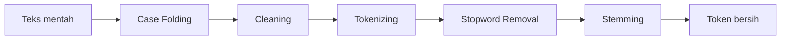

# Fitur 2: Sistem Pra-proses Teks (Preprocessing Pipeline)

## 1. Deskripsi
Pipeline yang mengubah teks mentah menjadi daftar token bersih. **Pipeline yang sama harus dipakai untuk dokumen DAN kueri** agar term keduanya konsisten.

## 2. Tahapan Pipeline


| No | Tahap | Penjelasan | Contoh |
|----|-------|-----------|--------|
| 1 | Case folding | Ubah menjadi huruf kecil | `Pemerintah Menaikkan` → `pemerintah menaikkan` |
| 2 | Cleaning | Hapus angka, tanda baca, simbol, URL, HTML | `harga 5.000!!` → `harga` |
| 3 | Tokenizing | Pecah teks menjadi kata | `harga naik` → `["harga","naik"]` |
| 4 | Stopword removal | Buang kata umum (yang, di, dan, untuk) | `["harga","yang","naik"]` → `["harga","naik"]` |
| 5 | Stemming | Ubah ke kata dasar (Sastrawi) | `menaikkan` → `naik` |

## 3. Kebutuhan Fungsional
| Kode | Kebutuhan |
|------|-----------|
| F2.1 | Seluruh 1.000 dokumen diproses otomatis saat indeksasi |
| F2.2 | Kueri pengguna diproses dengan pipeline identik |
| F2.3 | Menyimpan hasil tiap tahap untuk keperluan demo/laporan |
| F2.4 | Stopword dapat ditambah (daftar kustom) |
| F2.5 | Hasil stemming di-cache agar cepat |

## 4. Implementasi: `engine/preprocess.py`
```python
import re
from functools import lru_cache
from Sastrawi.Stemmer.StemmerFactory import StemmerFactory
from Sastrawi.StopWordRemover.StopWordRemoverFactory import StopWordRemoverFactory

_stemmer = StemmerFactory().create_stemmer()
_stopwords = set(StopWordRemoverFactory().get_stop_words())
_stopwords |= {"yaitu", "adalah", "akan", "juga"}   # tambahan kustom (opsional)


def case_folding(text: str) -> str:
    return text.lower()


def cleaning(text: str) -> str:
    text = re.sub(r"<[^>]+>", " ", text)          # tag HTML
    text = re.sub(r"http\S+|www\.\S+", " ", text) # URL
    text = re.sub(r"[^a-z\s]", " ", text)         # hanya huruf
    return re.sub(r"\s+", " ", text).strip()


def tokenizing(text: str) -> list[str]:
    return text.split()


def stopword_removal(tokens: list[str]) -> list[str]:
    return [t for t in tokens if t not in _stopwords and len(t) > 2]


@lru_cache(maxsize=None)
def _stem_word(word: str) -> str:
    return _stemmer.stem(word)


def stemming(tokens: list[str]) -> list[str]:
    return [_stem_word(t) for t in tokens]


def preprocess(text: str) -> list[str]:
    """Pipeline lengkap -> daftar token bersih."""
    text = case_folding(str(text))
    text = cleaning(text)
    tokens = tokenizing(text)
    tokens = stopword_removal(tokens)
    return stemming(tokens)


def preprocess_verbose(text: str) -> dict:
    """Mengembalikan hasil tiap tahap (untuk demo/laporan)."""
    t1 = case_folding(str(text))
    t2 = cleaning(t1)
    t3 = tokenizing(t2)
    t4 = stopword_removal(t3)
    t5 = stemming(t4)
    return {"case_folding": t1, "cleaning": t2, "tokenizing": t3,
            "stopword_removal": t4, "stemming": t5}
```

## 5. Contoh Hasil
**Input:** `"Pemerintah Menaikkan Harga BBM di 2024, masyarakat protes!"`

| Tahap | Output |
|-------|--------|
| Case folding | `pemerintah menaikkan harga bbm di 2024, masyarakat protes!` |
| Cleaning | `pemerintah menaikkan harga bbm di masyarakat protes` |
| Tokenizing | `['pemerintah','menaikkan','harga','bbm','di','masyarakat','protes']` |
| Stopword removal | `['pemerintah','menaikkan','harga','bbm','masyarakat','protes']` |
| Stemming | `['perintah','naik','harga','bbm','masyarakat','protes']` |

## 6. (Opsional) Halaman Demo Preprocessing
Tambahkan route `/preprocess?text=...` yang menampilkan tabel hasil tiap tahap memakai `preprocess_verbose()` — sangat membantu saat presentasi.

## 7. Catatan Performa
Stemming Sastrawi lambat (~beberapa detik hingga menit untuk 1000 dokumen). Karena itu:
- gunakan `lru_cache` pada stemming kata,
- **jalankan indeksasi sekali** lalu simpan ke `index.pkl`.

## 8. Pengujian
| ID | Input | Output Diharapkan |
|----|-------|-------------------|
| P1 | `"Harga BBM NAIK"` | `["harga","bbm","naik"]` |
| P2 | `"123 !!! ???"` | `[]` |
| P3 | `"yang dan di"` | `[]` |
| P4 | `"<p>Belajar</p>"` | `["ajar"]` |
| P5 | `"Menaikkan"` dan `"naik"` | Menghasilkan token sama |
